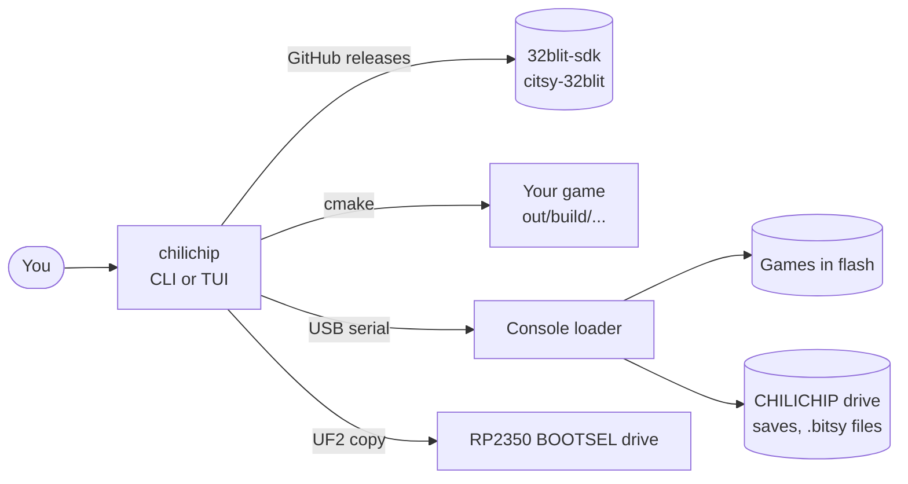

# chilichip CLI

`chilichip` is one command for everything you do with a ChiliChip console from your computer:

| Job | Command | What it does |
| --- | ------- | ------------ |
| Keep the console current | [`chilichip update`](update.md) | Installs the latest loader, home screen and Bitsy player. Games and saves stay. |
| Put games on it | [`chilichip install game.blit`](games.md) | Installs `.blit` games and `.bitsy` files over USB, no drive copying. |
| Start a game | [`chilichip new space-cat`](projects.md) | Makes a new game from the ChiliChip template. |
| Play it | [`chilichip run`](projects.md#run) | Builds the game and starts it on your computer or on the console. |

Run `chilichip` with no command to open the [TUI](tui.md), which does the same jobs with menus:

{ .tui }

## Quick start

```bash
pipx install git+https://github.com/chili-chip/chilichip-cli#subdirectory=src
chilichip update                      # bring the console up to date
chilichip new space-cat && cd space-cat
chilichip run                         # play it on your computer
chilichip run --console               # play it on the console
```

See [Install](install.md) for the details, including the USB permission step on Linux.

## How it fits together



* **Firmware** comes from the latest [32blit-sdk release](https://github.com/chili-chip/32blit-sdk/releases) (loader and home screen) and the latest [citsy-32blit release](https://github.com/chili-chip/citsy-32blit/releases) (Bitsy player).
* **Games** go over USB serial to the loader, the same way `32blit install` works.
* **Builds** use the CMake presets in the [game template](https://github.com/chili-chip/game-template).

## The 32blit command

`chilichip` is a fork of [32blit-tools](https://github.com/32blit/32blit-tools). Installing it also gives you the `32blit` command, which the SDK's CMake files call to pack images, fonts and maps into your game. See [The 32blit asset tools](32blit.md).

## Related docs

* [ChiliChip Game SDK](https://sdk.chilichip.eu/): how to write games.
* [Flashing and the loader](https://sdk.chilichip.eu/console/flashing/): the manual way to do what `chilichip update` does.
