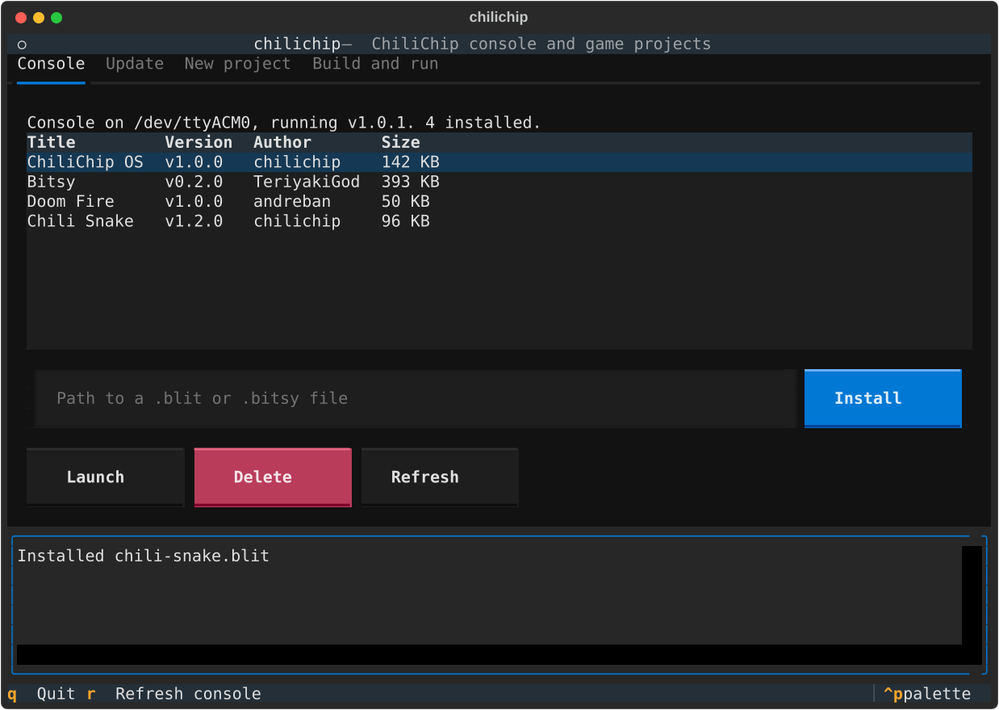
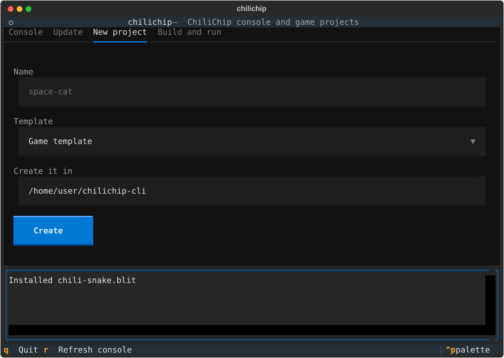
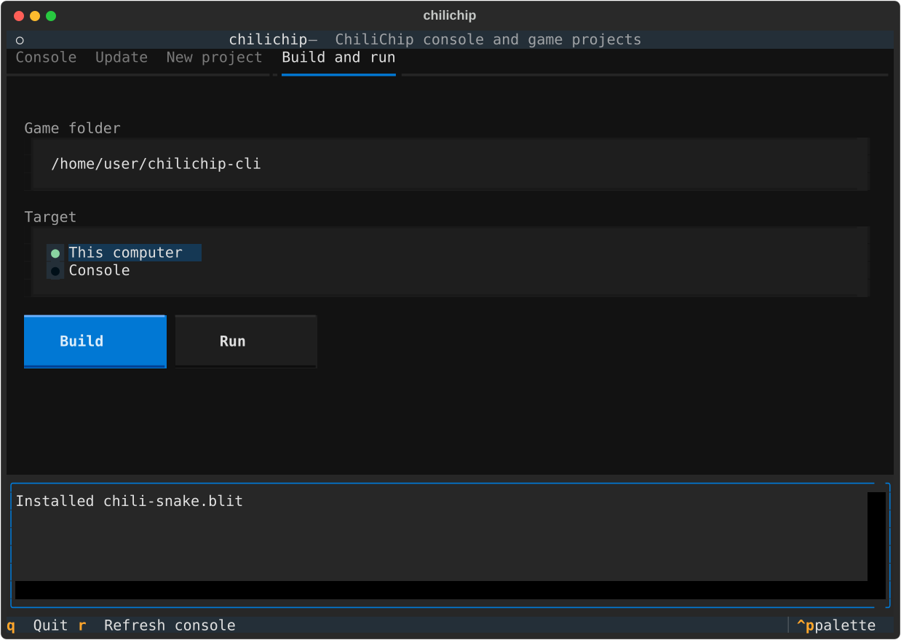

# The TUI

Run `chilichip` with no command:

```bash
chilichip
```

The TUI has one tab per job. Each tab calls the same code as the matching command, so it behaves the same way. Messages and build output appear in the log at the bottom.

| Key | Action |
| --- | ------ |
| ++tab++ / ++shift+tab++ | move between fields and buttons |
| ++left++ / ++right++ on the tab bar | switch tabs |
| ++enter++ | press the focused button |
| ++r++ | refresh the console |
| ++q++ | quit |
| ++ctrl+p++ | command palette (theme and more) |

The mouse works too.

## Console

{ .tui }

Shows the connected console, its loader version and the installed games.

* **Install**: type the path of a `.blit` or `.bitsy` file and press Install. The same [checks](games.md#checks-before-uploading) run first.
* **Launch**: starts the selected game.
* **Delete**: press twice to delete the selected game. Its saves stay.
* **Refresh**: reads the console again, for example after plugging it in.

## Update

{ .tui }

**Check for updates** downloads the latest firmware and lists what would change. **Update now** then flashes it, as [`chilichip update`](update.md) does. To set up a new console, use `chilichip update --factory` from the command line.

## New project

{ .tui }

Fill in the name, pick a template and the folder to create it in, then press **Create**. Missing SDKs are downloaded next to the game. The Build and run tab then points at the new game.

## Build and run

{ .tui }

Pick the game folder and the target, then press **Build** or **Run**. CMake output streams into the log. A desktop game runs in its own window; the log shows its output until you close it.
