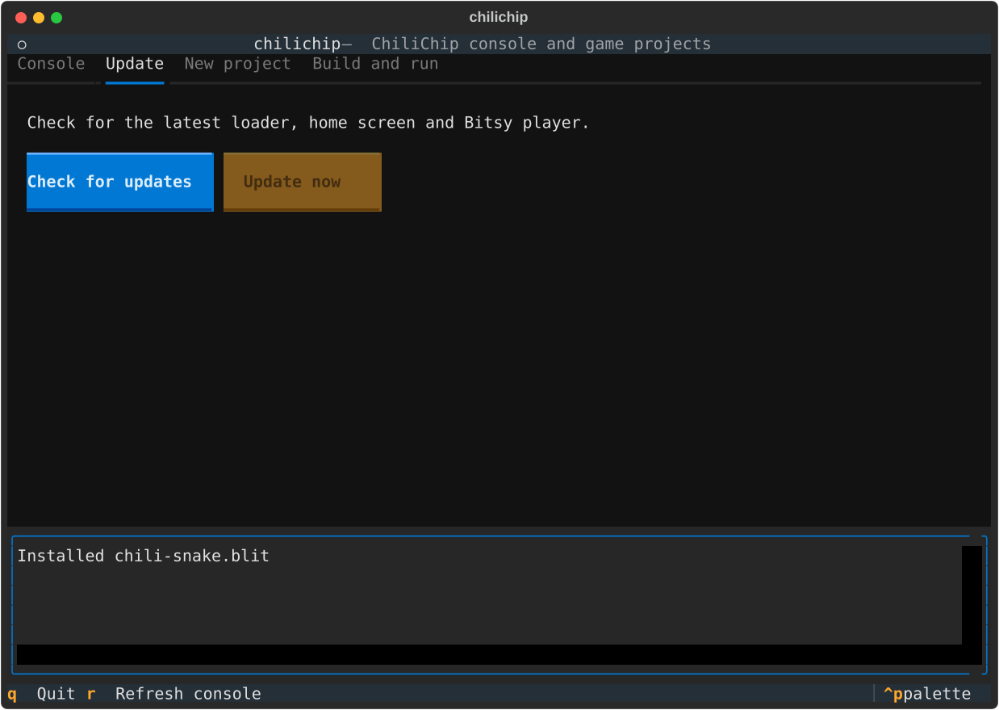
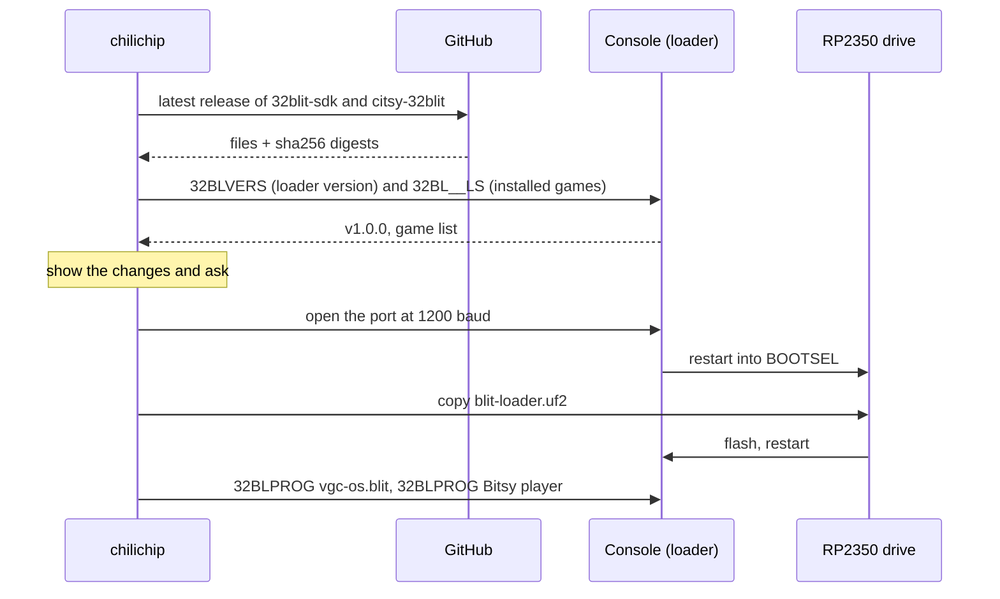

# Update the firmware

```bash
chilichip update
```

This brings a connected console to the latest firmware in one step. Installed games, saves and settings stay.

{ .tui }

## What gets installed

| Part | File | Comes from | How it is installed |
| ---- | ---- | ---------- | ------------------- |
| Loader (the system firmware) | `blit-loader.uf2` | [32blit-sdk](https://github.com/chili-chip/32blit-sdk/releases) release, `*-VGC-blit.zip` | BOOTSEL mode, UF2 copy |
| Home screen (ChiliChip OS) | `vgc-os.blit` | the same zip | USB serial, like a game |
| Bitsy player | `*.blit` | [citsy-32blit](https://github.com/chili-chip/citsy-32blit/releases) release | USB serial, like a game |

If the latest citsy-32blit release has no `.blit` file yet, `update` says so and installs the other two.

## What happens



1. **Download.** `chilichip` asks GitHub for the latest releases and downloads the files into its cache folder. Each file is checked against the sha256 digest GitHub publishes. A file that doesn't match is deleted and the update stops.
2. **Compare.** It asks the loader for its version, and reads the installed home screen and Bitsy player from the game list. A part is skipped when it is already current:
    * the loader, when its version is the same as or newer than the release;
    * the home screen and Bitsy player, when the installed copy has the same title, author and checksum.
3. **Ask.** It prints what changes and asks before flashing:

    ```console
    $ chilichip update
    Latest firmware: v1.0.1
    This update changes:
      Loader: v1.0.0 -> v1.0.1
      ChiliChip OS: v1.0.0 -> v1.0.0
    Installed games, saves and settings are kept.
    Update now? [y/N]: y
    Restarting the console into BOOTSEL mode...
    Copying blit-loader.uf2 to /media/ada/RP2350...
    Installing vgc-os.blit...
    Done. The console runs v1.0.1.
    ```

4. **Flash the loader.** It restarts the console into BOOTSEL mode with the "1200 baud touch" (opening the serial port at 1200 baud), waits for the `RP2350` drive, and copies `blit-loader.uf2` onto it. The console flashes itself and restarts.
5. **Install the rest.** When the console is back, it installs the home screen and the Bitsy player over USB serial.

Nothing to do? It says so and stops:

```console
$ chilichip update
Latest firmware: v1.0.1
The console is up to date (v1.0.1).
```

!!! info "Loaders older than the version command"
    Loaders built before the `32BLVERS` command don't report a version; they print `got: 32BLVERS` instead. `update` treats them as out of date and shows `Loader: unknown -> v1.0.1`. After one update, the version check works.

## If the console doesn't restart by itself

If no `RP2350` drive appears within 10 seconds, `update` asks you to do it by hand and waits up to two minutes:

1. Switch the console off.
2. Hold the top **X** button and switch it on.

The update carries on as soon as the drive appears.

## Options

| Option | Effect |
| ------ | ------ |
| `--yes`, `-y` | Don't ask before flashing. |
| `--force` | Flash everything, even parts that are already current. |
| `--factory` | Set up a new or wiped console. See below. |

## Set up a new console

```bash
chilichip update --factory
```

Use this for a console with no loader yet, or one that doesn't start. It copies `vgc-os-factory.uf2` (the loader with the home screen already in it) in BOOTSEL mode, then installs the Bitsy player.

* If the console is connected and running a loader, `chilichip` restarts it into BOOTSEL mode.
* Otherwise it asks you to hold **X** and switch it on.

!!! warning
    The factory image writes the home screen at 256 KB in flash. A game installed there is overwritten and needs installing again. Other games, saves and settings stay.

## Where the downloads go

Files are cached so a second run doesn't download them again:

| System | Cache folder |
| ------ | ------------ |
| Linux | `~/.config/chilichip/cache/` |
| macOS | `~/Library/Application Support/chilichip/cache/` |
| Windows | `%APPDATA%\chilichip\cache\` |

Delete the folder to free the space. Set `GITHUB_TOKEN` if you hit GitHub's API rate limit (60 requests an hour without a token).

## The manual way

`chilichip update` does the same steps as [Flashing and the loader](https://sdk.chilichip.eu/console/flashing/) in the SDK docs. Use those steps if you can't install `chilichip`.
